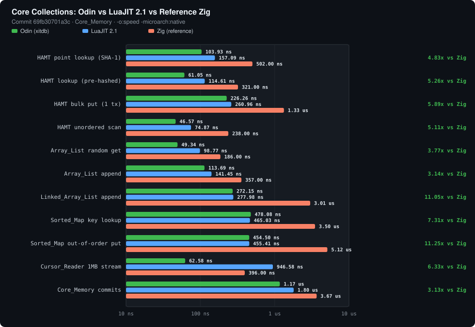
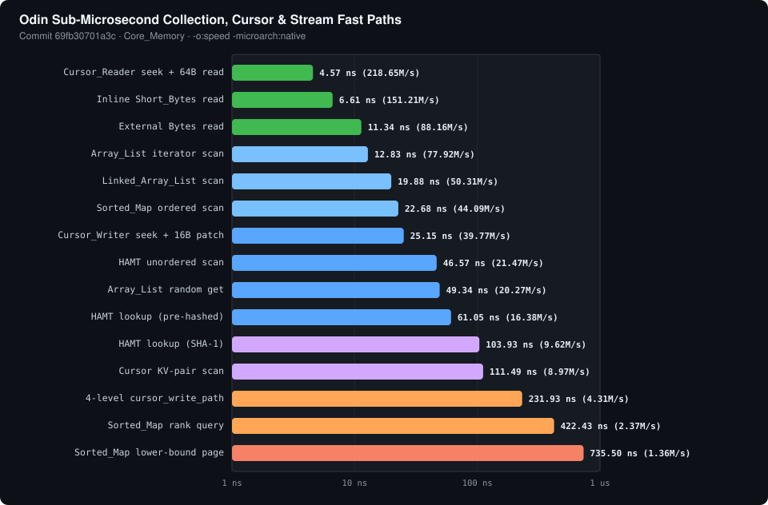
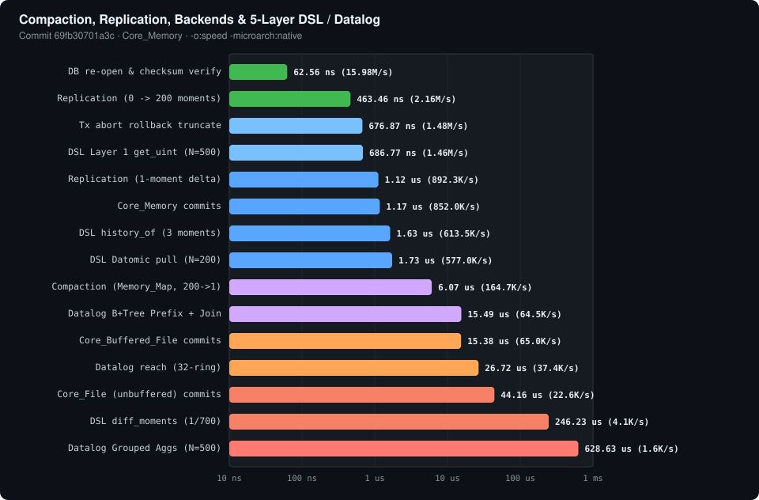

[Root README](../README.md) · **Suite Renders** · [Code Slices](slices/README.md) · [Zig Optimization Guide](zig-guide/README.md)

# xitdb Benchmarks & Visual Renders

Pure-Odin, LuaJIT 2.1, and reference Zig (`0.17`) immutable structural-sharing storage, persistent collection, compaction, replication, 5-layer DSL, and Datalog engine benchmark suite for **xitdb** (`75` Odin benchmarks across `7` groups, `525` Odin samples, paired with `75` LuaJIT and `63` Zig baselines at commit `69fb30701a3c` in [`history.hugidb`](history.hugidb)), with visual SVG charts rendered via [`temple`](https://github.com/boxxxie/temple) under [`renders/`](renders/).

---

## Visual Renders (`-o:speed`)

### 1. Core Collections & Backends: Odin vs LuaJIT 2.1 vs Reference Zig



### 2. Odin Sub-Microsecond Collection, Cursor & Stream Fast Paths



### 3. Compaction, Replication, Persistence Backends & 5-Layer DSL / Datalog



---

## Reproducing & Regenerating Renders

```bash
# 1. Run the Odin suite and append results to benchmarks/history.hugidb
hugi run benchmarks --runs 5 --warmup 1

# 2. Fetch Zig references on demand (instead of Git submodules) & run 1v1 comparison
./benchmarks/sync_zig_reference.sh
./benchmarks/compare_1v1.py --affected
odin run benchmarks/bench_lua.odin -file -collection:xitdb=./xitdb -o:speed -microarch:native

# 3. Statistically compare the last two commits (Mann-Whitney U / Welch t-test)
hugi compare --last --db benchmarks/history.hugidb

# 4. Regenerate SVG charts in benchmarks/renders/ and tables below using temple AOT templates
odin run benchmarks/render -collection:temple=../temple
```

> **Note on Zig references (`reference/xitdb-zig` & `reference/xitdb-zig-patched`):** Both checkouts are gitignored and fetched on demand via `./benchmarks/sync_zig_reference.sh` (pass `--latest` for `origin` HEADs instead of pinned SHAs) rather than tracked as Git submodules.

---

## Full Benchmark Results (`75` Benchmarks at `69fb30701a3c`)

<!-- BEGIN_BENCHMARK_TABLE -->
### `hamt` — Copy-on-Write 32-Way HAMT `Hash_Map`, `Counted_Hash_Map` & `Counted_Hash_Set` (`13` benchmarks)

Bulk puts, point lookups (with SHA-1 and pre-hashed digest), CoW branched moments, remove & branch shortening, and unordered scans.

| Benchmark | Odin (`p50`) | `P95` | Ops/s | `CV%` | vs Zig (`p50`) | vs LuaJIT (`p50`) | Allocs / op |
| :--- | ---: | ---: | ---: | ---: | ---: | ---: | ---: |
| `HAMT Hash_Map bulk put (1 tx)` | **226.26 ns** | 231.14 ns | 4.42M/s | 2.9% | **5.89x** (1.33 us) | **1.15x** (260.96 ns) | **0** |
| `HAMT Hash_Map point lookup (with SHA-1)` | **103.93 ns** | 106.70 ns | 9.62M/s | 1.8% | **4.83x** (502.00 ns) | **1.51x** (157.09 ns) | **0** |
| `HAMT Hash_Map lookup (pre-hashed digest)` | **61.05 ns** | 63.93 ns | 16.38M/s | 2.7% | **5.26x** (321.00 ns) | **1.88x** (114.61 ns) | **0** |
| `HAMT CoW branched moment commits` | **1.25 us** | 1.32 us | 802.1K/s | 3.3% | **3.15x** (3.93 us) | **1.46x** (1.82 us) | **0** |
| `HAMT Hash_Map remove & branch shortening` | **197.78 ns** | 220.44 ns | 5.06M/s | 6.5% | **8.07x** (1.60 us) | **1.19x** (236.02 ns) | **0** |
| `HAMT Hash_Map unordered iterator scan` | **46.57 ns** | 49.80 ns | 21.47M/s | 3.9% | **5.11x** (238.00 ns) | **1.61x** (74.87 ns) | **0** |
| `HAMT Hash_Map in-place overwrite (1 tx)` | **244.70 ns** | 266.24 ns | 4.09M/s | 4.3% | **5.20x** (1.27 us) | **1.07x** (262.48 ns) | **0** |
| `HAMT Counted_Hash_Map bulk put (1 tx)` | **232.35 ns** | 256.77 ns | 4.30M/s | 4.8% | **5.76x** (1.34 us) | **1.21x** (280.27 ns) | **0** |
| `HAMT Counted_Hash_Map remove` | **194.24 ns** | 207.51 ns | 5.15M/s | 3.6% | **8.61x** (1.67 us) | **1.24x** (240.70 ns) | **0** |
| `HAMT deep suffix-collision put (depth 10+)` | **233.54 ns** | 245.16 ns | 4.28M/s | 3.9% | **8.53x** (1.99 us) | **1.35x** (314.91 ns) | **0** |
| `HAMT deep suffix-collision branch collapse` | **229.33 ns** | 236.85 ns | 4.36M/s | 2.6% | **18.01x** (4.13 us) | **1.22x** (278.86 ns) | **0** |
| `HAMT Counted_Hash_Set key-only put (1 tx)` | **249.81 ns** | 261.18 ns | 4.00M/s | 2.6% | **3.76x** (939.00 ns) | **1.07x** (267.24 ns) | **0** |
| `HAMT Counted_Hash_Set membership check` | **101.74 ns** | 107.88 ns | 9.83M/s | 3.1% | **4.10x** (417.00 ns) | **1.32x** (134.34 ns) | **0** |
### `lists` — `Array_List` (32-Way Radix Trie) & `Linked_Array_List` (B-Tree) (`14` benchmarks)

Append, random `get`, iterator scans, middle insert/remove, concatenation/slicing, and index-seek pagination.

| Benchmark | Odin (`p50`) | `P95` | Ops/s | `CV%` | vs Zig (`p50`) | vs LuaJIT (`p50`) | Allocs / op |
| :--- | ---: | ---: | ---: | ---: | ---: | ---: | ---: |
| `Array_List (Radix Trie) append` | **113.69 ns** | 161.72 ns | 8.80M/s | 20.8% | **3.14x** (357.00 ns) | **1.24x** (141.45 ns) | **0** |
| `Array_List (Radix Trie) random get` | **49.34 ns** | 67.87 ns | 20.27M/s | 18.3% | **3.77x** (186.00 ns) | **2.00x** (98.77 ns) | **0** |
| `Array_List (Radix Trie) iterator scan` | **12.83 ns** | 17.59 ns | 77.92M/s | 18.3% | **4.13x** (53.00 ns) | **4.32x** (55.50 ns) | **0** |
| `Array_List (Radix Trie) in-place put` | **98.92 ns** | 135.13 ns | 10.11M/s | 17.6% | **3.31x** (327.00 ns) | **1.32x** (130.43 ns) | **0** |
| `Array_List (Radix Trie) index-seek page(10)` | **266.81 ns** | 273.13 ns | 3.75M/s | 1.7% | **9.03x** (2.41 us) | **3.27x** (873.46 ns) | **0** |
| `Array_List (Radix Trie) depth-collapse slice` | **882.67 ns** | 923.15 ns | 1.13M/s | 3.7% | **2.71x** (2.39 us) | **1.44x** (1.27 us) | **0** |
| `Linked_Array_List (B-Tree) append` | **272.15 ns** | 278.02 ns | 3.67M/s | 2.5% | **11.05x** (3.01 us) | **1.02x** (277.98 ns) | **0** |
| `Linked_Array_List (B-Tree) random get` | **250.34 ns** | 257.16 ns | 3.99M/s | 1.8% | **0.80x** (200.00 ns) | **1.20x** (300.55 ns) | **0** |
| `Linked_Array_List (B-Tree) iterator scan` | **19.88 ns** | 24.59 ns | 50.31M/s | 12.3% | **4.48x** (89.00 ns) | **3.16x** (62.79 ns) | **0** |
| `Linked_Array_List (B-Tree) middle insert` | **305.95 ns** | 318.70 ns | 3.27M/s | 3.0% | **10.84x** (3.32 us) | **1.30x** (397.61 ns) | **0** |
| `Linked_Array_List (B-Tree) middle remove` | **414.40 ns** | 460.43 ns | 2.41M/s | 6.5% | **8.45x** (3.50 us) | **1.16x** (481.08 ns) | **0** |
| `Linked_Array_List (B-Tree) concat + slice` | **1.98 us** | 2.13 us | 505.7K/s | 4.5% | **15.87x** (31.39 us) | **1.27x** (2.51 us) | **0** |
| `Linked_Array_List (B-Tree) in-place put` | **206.12 ns** | 208.32 ns | 4.85M/s | 1.6% | **9.52x** (1.96 us) | **1.18x** (242.94 ns) | **0** |
| `Linked_Array_List (B-Tree) index-seek page(10)` | **512.21 ns** | 520.81 ns | 1.95M/s | 1.4% | **6.52x** (3.34 us) | **2.36x** (1.21 us) | **0** |
### `sorted_map` — Persistent B+Tree `Sorted_Map` & `Sorted_Set` (`11` benchmarks)

Out-of-order puts, key lookup, `O(log N)` rank/index select, ordered scans, lower-bound pagination, and rebalancing removal.

| Benchmark | Odin (`p50`) | `P95` | Ops/s | `CV%` | vs Zig (`p50`) | vs LuaJIT (`p50`) | Allocs / op |
| :--- | ---: | ---: | ---: | ---: | ---: | ---: | ---: |
| `Sorted_Map (B+Tree) out-of-order put` | **454.50 ns** | 707.88 ns | 2.20M/s | 24.1% | **11.25x** (5.12 us) | **1.00x** (455.41 ns) | **0** |
| `Sorted_Map (B+Tree) key lookup` | **478.08 ns** | 773.91 ns | 2.09M/s | 25.2% | **7.31x** (3.50 us) | **0.97x** (465.03 ns) | **0** |
| `Sorted_Map (B+Tree) rank query` | **422.43 ns** | 662.14 ns | 2.37M/s | 25.0% | **7.20x** (3.04 us) | **0.94x** (397.73 ns) | **0** |
| `Sorted_Map (B+Tree) ordered scan` | **22.68 ns** | 40.55 ns | 44.09M/s | 35.8% | **3.88x** (88.00 ns) | **2.05x** (46.44 ns) | **0** |
| `Sorted_Map (B+Tree) lower-bound page(10)` | **735.50 ns** | 1.00 us | 1.36M/s | 18.1% | **6.51x** (4.79 us) | **1.84x** (1.35 us) | **0** |
| `Sorted_Map (B+Tree) remove & rebalance` | **302.31 ns** | 494.21 ns | 3.31M/s | 32.1% | **17.38x** (5.25 us) | **1.01x** (305.94 ns) | **0** |
| `Sorted_Map (B+Tree) get_index select` | **358.28 ns** | 533.35 ns | 2.79M/s | 22.6% | **0.82x** (294.00 ns) | **1.04x** (372.87 ns) | **0** |
| `Sorted_Map (B+Tree) index-seek page(10)` | **606.95 ns** | 903.49 ns | 1.65M/s | 20.1% | **7.19x** (4.36 us) | **2.18x** (1.32 us) | **0** |
| `Sorted_Map (B+Tree) in-place overwrite` | **430.42 ns** | 729.87 ns | 2.32M/s | 27.8% | **9.01x** (3.88 us) | **0.99x** (425.26 ns) | **0** |
| `Sorted_Set (B+Tree) key-only put (1 tx)` | **406.94 ns** | 646.57 ns | 2.46M/s | 24.7% | **10.86x** (4.42 us) | **0.94x** (383.55 ns) | **0** |
| `Sorted_Set (B+Tree) contains lookup` | **461.96 ns** | 740.47 ns | 2.16M/s | 25.7% | **7.06x** (3.26 us) | **0.92x** (425.85 ns) | **0** |
### `compaction` — History Compaction & Incremental Delta Replication (`6` benchmarks)

Genesis-to-200 replication, incremental moment deltas, in-memory & file offset-map compaction, heterogeneous DAG dedup, and post-compaction resync.

| Benchmark | Odin (`p50`) | `P95` | Ops/s | `CV%` | vs Zig (`p50`) | vs LuaJIT (`p50`) | Allocs / op |
| :--- | ---: | ---: | ---: | ---: | ---: | ---: | ---: |
| `Replication (genesis -> 200 moments)` | **463.46 ns** | 605.74 ns | 2.16M/s | 15.3% | **5.50x** (2.55 us) | **1.93x** (893.48 ns) | **0** |
| `Replication (incremental 1-moment delta)` | **1.12 us** | 1.29 us | 892.3K/s | 8.9% | **2.63x** (2.95 us) | **1.95x** (2.18 us) | **0** |
| `Compaction (Memory_Offset_Map, 200 -> 1)` | **6.07 us** | 7.13 us | 164.7K/s | 9.8% | **3.53x** (21.44 us) | **0.58x** (3.51 us) | **0** |
| `Compaction (File_Offset_Map, 200 -> 1)` | **13.60 us** | 14.90 us | 73.6K/s | 5.6% | **2.99x** (40.64 us) | **0.85x** (11.52 us) | **0** |
| `Compaction (Heterogeneous DAG + dedup)` | **43.60 us** | 51.49 us | 22.9K/s | 9.0% | **6.21x** (270.78 us) | **1.07x** (46.65 us) | **0** |
| `Replication (Post-compaction resync)` | **1.41 us** | 1.49 us | 707.7K/s | 3.7% | **1.98x** (2.79 us) | **7.43x** (10.50 us) | **0** |
### `hashers` — Cryptographic Hashers, Inline Bytes, Streams & Nested Paths (`13` benchmarks)

SHA-1 vs SHA-256 HAMT puts, inline short bytes vs external slot reads, 1 MB cursor streams, and 4-level nested path reads/writes.

| Benchmark | Odin (`p50`) | `P95` | Ops/s | `CV%` | vs Zig (`p50`) | vs LuaJIT (`p50`) | Allocs / op |
| :--- | ---: | ---: | ---: | ---: | ---: | ---: | ---: |
| `Hasher: SHA-1 (20B) HAMT put` | **204.04 ns** | 295.09 ns | 4.90M/s | 19.0% | **6.38x** (1.30 us) | **1.25x** (254.26 ns) | **0** |
| `Hasher: SHA-256 (32B) HAMT put` | **215.78 ns** | 283.79 ns | 4.63M/s | 15.9% | **7.11x** (1.53 us) | **1.21x** (260.38 ns) | **0** |
| `Bytes: Inline Short_Bytes read_bytes_buf` | **6.61 ns** | 10.75 ns | 151.21M/s | 29.6% | **2.12x** (14.00 ns) | **4.77x** (31.52 ns) | **0** |
| `Bytes: External Bytes read_bytes_buf` | **11.34 ns** | 18.52 ns | 88.16M/s | 26.4% | **5.47x** (62.00 ns) | **3.23x** (36.69 ns) | **0** |
| `Bytes: Tagged Short_Bytes read_bytes_buf` | **6.69 ns** | 12.35 ns | 149.53M/s | 33.4% | **2.09x** (14.00 ns) | **5.81x** (38.84 ns) | **0** |
| `Bytes: Tagged External Bytes read_bytes_buf` | **11.71 ns** | 21.19 ns | 85.41M/s | 30.1% | **7.69x** (90.00 ns) | **3.75x** (43.93 ns) | **0** |
| `Stream: Cursor_Writer (256 x 4KB = 1MB)` | **1.50 us** | 2.28 us | 668.7K/s | 22.0% | **2.43x** (3.64 us) | **2.17x** (3.24 us) | **0** |
| `Stream: Cursor_Reader (256 x 4KB = 1MB)` | **62.58 ns** | 319.92 ns | 15.98M/s | 93.1% | **6.33x** (396.00 ns) | **15.13x** (946.58 ns) | **0** |
| `Stream: Cursor_Reader random seek + 64B read` | **4.57 ns** | 7.83 ns | 218.65M/s | 29.9% | **12.24x** (56.00 ns) | **23.50x** (107.48 ns) | **0** |
| `Stream: Cursor_Writer random seek + 16B patch` | **25.15 ns** | 41.33 ns | 39.77M/s | 26.6% | **2.35x** (59.00 ns) | **5.00x** (125.81 ns) | **0** |
| `Path: 4-level nested cursor_write_path` | **231.93 ns** | 383.64 ns | 4.31M/s | 26.1% | **8.49x** (1.97 us) | **2.96x** (686.25 ns) | **0** |
| `Path: 4-level nested cursor_read_path` | **253.16 ns** | 412.43 ns | 3.95M/s | 25.3% | **4.82x** (1.22 us) | **2.58x** (651.88 ns) | **0** |
| `Cursor: Full KV-pair scan (read_kv_pair)` | **111.49 ns** | 164.86 ns | 8.97M/s | 21.4% | **4.05x** (452.00 ns) | **1.80x** (200.37 ns) | **0** |
### `backends` — `Core_Memory`, `Core_Buffered_File` & `Core_File` Commits (`6` benchmarks)

Backend commit throughput, mid-tx `database_freeze` CoW clones, rollback truncation, and trailer checksum verification.

| Benchmark | Odin (`p50`) | `P95` | Ops/s | `CV%` | vs Zig (`p50`) | vs LuaJIT (`p50`) | Allocs / op |
| :--- | ---: | ---: | ---: | ---: | ---: | ---: | ---: |
| `Backend: Core_Memory commits` | **1.17 us** | 1.22 us | 852.0K/s | 2.4% | **3.13x** (3.67 us) | **1.54x** (1.80 us) | **0** |
| `Backend: Core_Buffered_File commits` | **15.38 us** | 15.75 us | 65.0K/s | 2.0% | **1.76x** (27.09 us) | **1.01x** (15.47 us) | **0** |
| `Backend: Core_File (unbuffered) commits` | **44.16 us** | 44.77 us | 22.6K/s | 1.2% | **1.57x** (69.49 us) | **0.95x** (41.75 us) | **0** |
| `Tx: Mid-tx database_freeze + CoW clone` | **1.19 us** | 1.21 us | 838.3K/s | 2.3% | **2.16x** (2.57 us) | **1.30x** (1.55 us) | **0** |
| `Tx: Aborted transaction rollback truncate` | **676.87 ns** | 692.62 ns | 1.48M/s | 3.1% | **3.98x** (2.69 us) | **4.60x** (3.11 us) | **0** |
| `DB: Re-open & trailer checksum verify` | **62.56 ns** | 64.91 ns | 15.98M/s | 2.6% | **5.79x** (362.00 ns) | **4.21x** (263.47 ns) | **0** |
### `dsl` — 5-Layer Path Selector, Reflection, Diff & Datalog Engine (`12` benchmarks)

String selectors, secondary indexes (`tx_index_on`), struct `marshal`/`unmarshal`/`pull`, structural `diff_moments`, and cycle-safe `query_datalog`.

| Benchmark | Odin (`p50`) | `P95` | Ops/s | `CV%` | vs Zig (`p50`) | vs LuaJIT (`p50`) | Allocs / op |
| :--- | ---: | ---: | ---: | ---: | ---: | ---: | ---: |
| `DSL Layer 2: Tx Commit + Secondary Index (N=500)` | **4.35 us** | 4.50 us | 229.9K/s | 1.9% | — | **1.41x** (6.12 us) | **0** |
| `DSL Layer 1: String Selector get_uint (N=500)` | **686.77 ns** | 691.27 ns | 1.46M/s | 1.5% | — | **1.10x** (757.00 ns) | **0** |
| `DSL Layer 3: Struct marshal (N=200)` | **3.92 us** | 4.07 us | 254.9K/s | 2.0% | — | **1.09x** (4.28 us) | **0** |
| `DSL Layer 3: Struct unmarshal (N=200)` | **2.02 us** | 2.04 us | 496.2K/s | 1.1% | — | **1.22x** (2.45 us) | **0** |
| `DSL Layer 3: Datomic pull projection (N=200)` | **1.73 us** | 1.84 us | 577.0K/s | 3.0% | — | **1.45x** (2.51 us) | **0** |
| `DSL Layer 4: diff_moments (1 of 700 mutated)` | **246.23 us** | 252.81 us | 4.1K/s | 1.3% | — | **0.99x** (242.59 us) | **0** |
| `DSL Layer 4: history_of lineage (3 moments)` | **1.63 us** | 1.72 us | 613.5K/s | 4.3% | — | **2.07x** (3.37 us) | **0** |
| `DSL Layer 5: Datalog B+Tree Prefix + Join` | **15.49 us** | 16.07 us | 64.5K/s | 2.0% | — | **1.36x** (21.08 us) | **0** |
| `DSL Layer 5: Datalog Grouped Aggs (N=500)` | **628.63 us** | 666.48 us | 1.6K/s | 3.2% | — | **1.08x** (681.77 us) | **0** |
| `DSL Layer 5: Datalog Cycle-Safe reach (32-ring)` | **26.72 us** | 27.29 us | 37.4K/s | 1.2% | — | **1.67x** (44.75 us) | **0** |
| `DSL Layer 2: Secondary Index Evict+Update (N=200)` | **3.20 us** | 3.46 us | 312.1K/s | 4.5% | — | **1.09x** (3.50 us) | **0** |
| `DSL Layer 3/4: Cyclic Graph pull + diff (N=200)` | **7.51 us** | 7.89 us | 133.1K/s | 3.3% | — | **1.22x** (9.13 us) | **0** |
<!-- END_BENCHMARK_TABLE -->

---

## Deep-Dive Guides & Storage Backends

* [**Per-Benchmark Code Slices (`slices/README.md`)**](slices/README.md) — Exact `xitdb/*.odin` and reference `lib.zig` implementation diffs for every benchmark.
* [**Idiomatic Zig Optimization Guide (`zig-guide/README.md`)**](zig-guide/README.md) — Six standalone engineering deep dives (`CoreMemory`, `LinkedArrayList`, `SortedMap`, `HAMT`, `Cursor & Paths`, `CoreBufferedFile & Compactor`).
* **Storage Backends (`Core_Memory` / `Core_Buffered_File` / `Core_File`):** `Core_Memory` isolates CPU & trie overhead without OS syscall variance; `Core_Buffered_File` models production tail-window buffering; `Core_File` provides the unbuffered syscall baseline.
